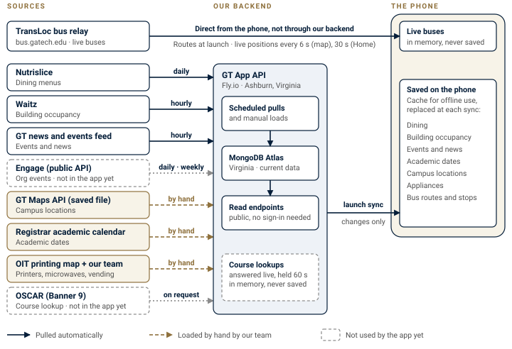
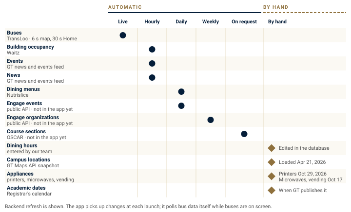
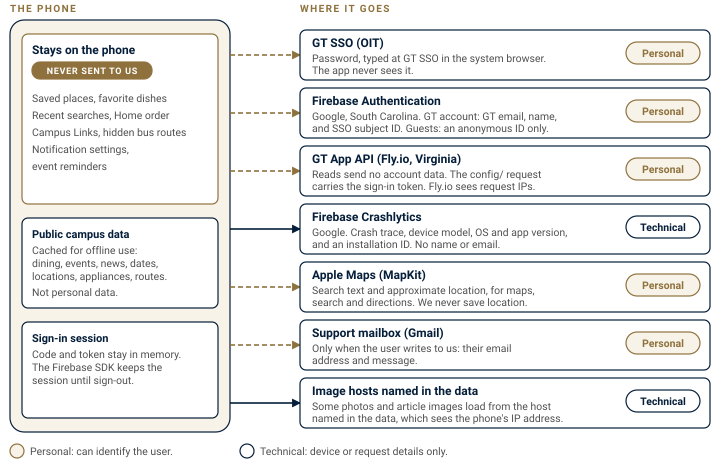
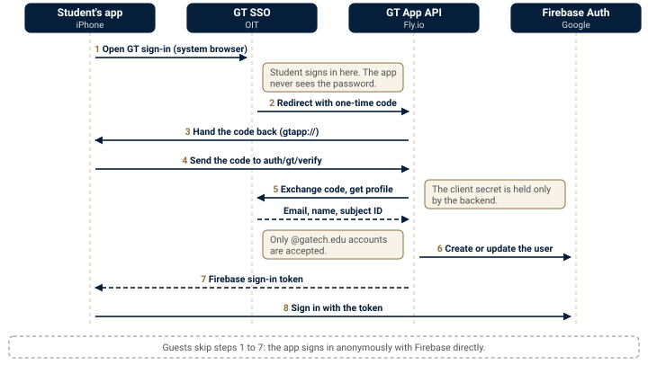

Data sources for the Georgia Tech App · Last updated November 2, 2026

This document lists every set of data the Georgia Tech App receives, stores or sends, where it is hosted, and who to contact about it. The app is built and maintained by GT iOS Club in partnership with SGA.

## Overview

| Data source | Upstream source | Contact | Refresh | Server retention | Status |
|---|---|---|---|---|---|
| Dining | Nutrislice menus; hours entered by our team | GT Dining Services (Houston Freeman) | Backend daily; app at launch | MongoDB Atlas, current menus and hours | Live |
| Buses | TransLoc via bus.gatech.edu | Parking and Transportation Services (Derrick Walker) | Live: every 6 s on map, 30 s on Home | None | Live; hybrid historical predictions with TransLoc fallback |
| Campus locations | GT Maps' API, saved as a file in our backend | Capital Planning and Space Management (Jason Gregory) | Not automatic; app at launch when changed | MongoDB Atlas, current list | Live; snapshot of GT Maps, automatic refresh in development |
| Building occupancy | Waitz | Not yet identified | Backend hourly; app at launch | MongoDB Atlas, latest snapshot | Live |
| Appliances | Locations recorded by our team; printers also from OIT's printing locations map | Printers: OIT (Michael Teed); others not yet identified | Manual; app at launch when changed | MongoDB Atlas, current list | Live; updated by hand, no official feed for microwaves and vending |
| Events | GT news and events feed | Institute Communications | Backend hourly; app at launch | MongoDB Atlas, upcoming events | Live |
| News | GT news and events feed | Institute Communications (Abbigail Tumpey, Doug Goodwin) | Backend hourly; app at launch | MongoDB Atlas, accumulated articles | Live |
| Academic dates | The academic calendar GT publishes, downloaded and entered by our team | Office of the Registrar (contact not yet identified) | Manual; app at launch when changed | MongoDB Atlas, date list | Live; dates being entered by hand |
| Course information (BuzzAPI) | BuzzAPI, GT's course information API | OIT (Jesse) | Not applicable | None | Not in use |
| Course sections (OSCAR) | OSCAR, GT's course registration system | Not yet identified | On request only; the app does not call it yet | None; held 60 seconds in server memory | Built in the backend; not shown in the app |
| Public Engage data (events and organizations) | Engage's public API; we do not have Engage access, full access to be determined | Student Life (Kayla Watson) | Backend daily (events), weekly (organizations) | MongoDB Atlas, latest snapshot | Stored; not yet shown in the app |
| Sign-in | GT SSO and Firebase Authentication | OIT (Bert) | At sign-in | Firebase user record | Live |
| Apple MapKit and location | Apple | Not applicable | On demand | None on our side | Live |
| On-device user data | The user | Not applicable | On demand | None; never leaves the device | Live |
| Crash reports | The app, through Firebase Crashlytics | GT iOS Club app team | After a crash | Firebase Crashlytics | Live |
| Bundled content | Public GT sources | GT iOS Club app team | With each app update | None | Live |
| Support email | The user | GT iOS Club app team | When the user writes | Support mailbox | Live |

## How data reaches the app

- **GT App API (our backend).** Collects public GT data, stores it in our database, and sends it to the app. It runs on Fly.io.
- **TransLoc bus relay.** The app calls GT's bus relay (bus.gatech.edu) directly for routes and live buses. Parking and Transportation Services is aware of this.
- **Apple MapKit and CoreLocation.** Map, place search, directions, and the user's location.
- **GT SSO and Firebase Authentication.** Sign-in.
- **Firebase Crashlytics.** Crash reports.
- **Image links.** Some photos and article images load directly from the host named in the data, so that host sees the device's IP address.

### Where data is stored

| System | What it holds | Region |
|---|---|---|
| Fly.io | Runs the GT App API and its scheduled data pulls. Holds no database. | Ashburn, Virginia (iad), one machine |
| MongoDB Atlas | Everything the GT App API serves (dining, locations, occupancy, appliances, events, news, dates, public Engage events and organizations) | Virginia |
| Firebase Authentication (Google) | Account records (see Sign-in) | South Carolina (us-east1) |
| Firebase Crashlytics (Google) | Crash reports (see Crash reports) | Managed by Google |
| The user's device | Cached data and user-created data | On the device |
| Support mailbox | Emails users send us | Gmail |

### Hosting, access and logging

- **Hosting.** The API is the Fly.io app `gt-app` (gt-app.fly.dev). Scheduled data pulls run inside the same process.
- **Reading data.** All data endpoints are readable without signing in. They hold public campus information only. Only the `config/` endpoint requires a Firebase sign-in token.
- **Rate limits.** 120 requests per minute per client, 30 per minute for course lookups, and 10 per minute for the sign-in exchange.
- **Changing data.** Manual updates (dates, events, occupancy) and manual scraper runs require a secret admin token held by our team. If the token is not configured on the production server, these operations are locked.
- **Secrets.** The GT SSO client secret is held only by the backend. It is not in the app.
- **Logging.** We have not set up log shipping, analytics or a third-party logging service. Fly.io keeps recent application logs (what the API prints, such as data-pull status and sign-in errors) and sees the IP address of each request.

### Data sync

- Once per launch, after sign-in, the app checks `metadata/` for what changed.
- It downloads only the data types that changed.
- Data is cached on the device in SwiftData (SQLite), so the app works offline.
- Cached data has no expiry; the next successful sync replaces it.
- If a sync fails, the cache stays and the app retries next launch.
- The tables below call this the launch sync.

### Backend data sources

| Endpoint | Upstream source | How the backend gets it |
|---|---|---|
| dining/ | Menus: Nutrislice, GT Dining's menu platform. Hours: entered by our team. | Pulled daily; hours edited in the database |
| capacity/ | Waitz building occupancy API | Pulled hourly |
| events/ | GT news and events feed (the same feed as news/) | Pulled hourly; the feed rotates, so the backend accumulates events into one upcoming list |
| news/ | GT news and events feed (Institute news plus outside coverage) | Pulled hourly; accumulated newest-first |
| dates/ | The academic calendar GT publishes (Registrar) | Downloaded by our team and loaded by hand; not automatic |
| map/ | GT Maps' API (Concept3D): campus buildings, parking decks and other locations | Pulled from the GT Maps API and saved as a file in our backend (last updated April 21, 2026), then loaded into the database by a manual run. The backend does not call the API on a schedule, so the data does not refresh by itself. Automatic refresh is in development. |
| printer/, microwave/, vending/ | Printers: OIT's printing locations map combined with locations our team recorded. Microwaves and vending machines: recorded by our team. | Kept in files in our backend (printers October 29, 2026; microwaves and vending October 17, 2026) and loaded by hand; not automatic |
| engage/events, engage/categories, engage/organizations | Engage's public discovery API, called without signing in. We do not have Engage access from GT; full access is to be determined. | Events and categories pulled daily; organizations pulled weekly; each pull replaces the previous snapshot. The app does not call these yet. |
| courses/ | OSCAR, GT's course registration system (Banner 9), using its public search without signing in | Looked up live when requested and held 60 seconds in server memory; nothing is saved. The app does not call it yet. |
| metadata/ | Generated by the backend: one last-updated time per data type | Updated when that data type changes |
| auth/gt/callback, auth/gt/verify/ | GT SSO (OIDC) | Called at sign-in only |

## Personal data and student data

The app does not access student education records. It never receives grades, a student's own enrollment or class schedule, financial or BuzzCard data, or GT ID numbers. The backend's course lookup returns public section information, such as open seats, and nothing about any student.

| Data | Personal data? | Student-record data? | Where it lives |
|---|---|---|---|
| Sign-in account (GT accounts) | Yes: GT email, name, and the GT SSO subject ID | No | Firebase Authentication |
| Guest account | No: anonymous user ID only | No | Firebase Authentication |
| On-device user data (saved places, recents, reminders, settings) | Yes, but only on the device | No | The user's device; never sent to us |
| Support emails | Yes: the sender's email and message | No | Support mailbox |
| Crash reports | Technical data only: device model, OS and app version, an installation ID. No name or email. | No | Firebase Crashlytics |
| Location | Used live, never saved | No | Apple; not stored by us |
| Event contact lines | May include an organizer's name or email as published in the GT feed | No | MongoDB Atlas |
| Course lookup (not used by the app yet) | Instructor names, and emails where OSCAR lists them, as OSCAR publishes them | No | Not stored; held 60 seconds in server memory |
| All other data sources | No: public campus information | No | MongoDB Atlas or bundled |

## Feature List

| Feature | Data sources |
|---|---|
| Home | Dining, Building occupancy, Events, Academic dates, Buses, Apple location, Sign-in (first name), On-device user data, Bundled content |
| Map and search | Campus locations, Dining, Appliances, Buses, Apple Maps and location, On-device user data |
| Dining | Dining, On-device user data (saved places and dishes) |
| Transportation | Buses, Apple Maps and location |
| Building occupancy | Building occupancy, Campus locations |
| Appliances | Appliances, Campus locations (parking decks) |
| Events and news | Events, News, On-device user data (event reminders) |
| Account and settings | Sign-in, On-device user data (notification settings), Support email |

## Data Sources

### 1. Dining

| | |
|---|---|
| What it is | Dining hall and restaurant information: where to eat, when each place is open, and what is on the menu. |
| Data needed | Restaurant name, address, coordinates, type, hours, accepted payments, image; weekly menus by meal period and station, food names, ingredients, serving sizes, nutrition, dietary tags |
| Department | Georgia Tech Dining Services |
| Contact | Houston Freeman, hfreeman@dining.gatech.edu |
| Storage location | Menus from Nutrislice; hours maintained by our team. Stored in MongoDB Atlas (Virginia), served by the GT App API. |
| Retrieval method | Backend pulls from Nutrislice. App calls dining/ over HTTPS (JSON). |
| Retrieval frequency | Backend: daily. App: launch sync. |
| On-device retention | SwiftData. Replaced in full on each successful sync; no expiry. |
| Server retention | MongoDB Atlas holds the current menus and hours. |
| Known issues | Hours are entered by hand, so special and holiday hours can be wrong; automatic hours updates are in progress. Some new restaurants have no menu data yet. |

### 2. Buses (TransLoc)

| | |
|---|---|
| What it is | GT's campus bus system, with routes, stops, live bus locations and arrival times. |
| Data needed | Routes, route colors and lines, running status, stops; live vehicle position, heading, speed and capacity; arrival estimates per stop |
| Department | Parking and Transportation Services |
| Contact | Derrick Walker, derrick.walker@pts.gatech.edu |
| Storage location | TransLoc, through GT's relay at bus.gatech.edu/Services/JSONPRelay.svc. Does not pass through our backend. Parking and Transportation Services is aware the app calls the relay directly. |
| Retrieval method | HTTPS calls from the device: GetRoutesForMapWithScheduleWithEncodedLine, GetMapVehiclePoints, GetVehicleCapacities, GetStopArrivalTimes (batched stop IDs), GetVehicleRouteStopEstimates (batched vehicle IDs) |
| Retrieval frequency | Routes and stops: once per launch, with a five-minute in-memory route-definition cache for calculations. Live data: every 6 seconds while the map shows buses, every 30 seconds while Home's Next Bus card is visible, off when neither is on screen. Also on demand when planning a bus route. |
| On-device retention | Routes and stops in SwiftData until the next successful sync. Historical journey averages and offsets bundled with the app. Live data in memory only, never written to disk. |
| Server retention | None. We do not store bus data on a server. |
| Prediction method and planned work | Live next-stop estimates plus bundled 120-minute New York historical journey buckets (no all-day tables) and route/distance offsets, falling back to TransLoc when inputs are missing or ambiguous. Validate accuracy against actual arrivals. GT expects its bus-tracking vendor to change on June 30, 2027; this section will change when it does. |
| Known issues | TransLoc estimates near a waiting bus can be inaccurate. The integrated historical correction needs field validation; missing or changed route history uses TransLoc. |

### 3. Campus locations

| | |
|---|---|
| What it is | The list of campus places shown on the map: academic buildings, athletic facilities, residence halls, parking decks and more. |
| Data needed | Place name, abbreviation, coordinates, photo, details, type (academic, athletics, housing, parking, and other) |
| Department | Capital Planning and Space Management (GIS) |
| Contact | Jason Gregory, jason.gregory@cpsm.gatech.edu |
| Storage location | Taken from the GT Maps API (Concept3D) and saved as a file in our backend (last updated April 21, 2026), loaded into MongoDB Atlas (Virginia) and served by the GT App API. Building photos ship inside the app. |
| Retrieval method | Backend: data pulled from the GT Maps API and saved as a file, then loaded into the database by a manual run. App: calls map/ over HTTPS; records are updated by ID. |
| Retrieval frequency | Backend: a snapshot, not refreshed automatically. App: launch sync. |
| On-device retention | SwiftData. Updated in place; records the server drops are deleted; no expiry. |
| Server retention | MongoDB Atlas holds the current location list. |
| Known issues | The data is a snapshot of GT Maps, so it can fall behind when GT Maps changes. We want it to refresh automatically from the GT Maps API, and that work is in development. |

### 4. Building occupancy

| | |
|---|---|
| What it is | How busy campus buildings are, such as the CRC and the library. |
| Data needed | Per building: name, headcount, percent full, capacity, open/closed, next-hour trend, and the same for sub-areas |
| Department | Waitz (third-party occupancy provider for GT) |
| Contact | Not yet identified |
| Storage location | Waitz API, copied into MongoDB Atlas (Virginia) by the backend, served by the GT App API |
| Retrieval method | Backend pulls from Waitz. App calls capacity/ over HTTPS. |
| Retrieval frequency | Backend: hourly. App: launch sync, plus pull-to-refresh on the occupancy screen. |
| On-device retention | SwiftData. Replaced in full on each successful sync; no expiry. |
| Server retention | MongoDB Atlas holds the latest snapshot. |
| Known issues | Numbers are up to an hour old, but the app does not show when they were last updated. Being addressed in November. |

### 5. Appliances (printers, microwaves, vending)

| | |
|---|---|
| What it is | Printer, microwave and vending machine locations, pinned on the campus map and listed in search. |
| Data needed | Building, floor, room, coordinates, details; for printers, whether they print in color |
| Department | Printers: OIT (printing locations map). Microwaves and vending machines: not yet identified. |
| Contact | Printers: Michael Teed, mike.teed@oit.gatech.edu. Microwaves and vending machines: not yet identified. |
| Storage location | Printers: OIT's printing locations map combined with locations our team recorded (updated October 29, 2026). Microwaves and vending machines: recorded by our team (updated October 17, 2026). All are kept in files in our backend, loaded into MongoDB Atlas (Virginia) and served by the GT App API. |
| Retrieval method | The app calls printer/, microwave/ and vending/ over HTTPS at the same time and saves all three together. If any one call fails, the app keeps its existing appliance data and tries again next launch. |
| Retrieval frequency | Files: manual. A team member updates the files and runs the load by hand. App: launch sync. |
| On-device retention | SwiftData. Replaced in full on each successful sync; no expiry. |
| Server retention | MongoDB Atlas holds the current location list. |
| Known issues | Appliance locations are updated by hand, so they can be out of date or incomplete. Microwaves and vending machines have no official GT source to update from. Printers come from OIT's map, which we update by hand. |

### 6. Events

| | |
|---|---|
| What it is | Upcoming campus events shown in the Events tab and on Home. |
| Data needed | Up to 500 upcoming events: title, description, start and end time, location, categories, audience, host groups, contact line, links |
| Department | Institute Communications (the same feed as News) |
| Contact | Same as News: Abbigail Tumpey, atumpey@gatech.edu; Doug Goodwin, dgoodwin32@gatech.edu |
| Storage location | GT news and events feed, accumulated by the backend in MongoDB Atlas (Virginia), served by the GT App API |
| Retrieval method | Backend pulls the feed. App calls events/?limit=500 over HTTPS; records are updated by ID. |
| Retrieval frequency | Backend: hourly. App: launch sync. |
| On-device retention | SwiftData. Events are deleted when the server stops returning them (after they pass). |
| Server retention | MongoDB Atlas keeps accumulated upcoming events. |

### 7. News

| | |
|---|---|
| What it is | Georgia Tech news stories shown in the Events and News tab. |
| Data needed | Up to 200 articles: title, subtitle, summary, body, categories, publish date, publication, article link, image |
| Department | Institute Communications |
| Contact | Abbigail Tumpey, atumpey@gatech.edu; Doug Goodwin, dgoodwin32@gatech.edu (source of our feed details). Fletcher Moore is lead developer on the news database. |
| Storage location | GT news and events feed, accumulated by the backend in MongoDB Atlas (Virginia), served by the GT App API. Article images load from the feed's image links. |
| Retrieval method | Backend pulls the feed. App calls news/?limit=200 over HTTPS; records are updated by ID. |
| Retrieval frequency | Backend: hourly. App: launch sync. |
| On-device retention | SwiftData. Articles the server drops are deleted; no expiry. |
| Server retention | MongoDB Atlas keeps accumulated articles. |

### 8. Academic dates

| | |
|---|---|
| What it is | Official academic dates and deadlines, such as registration windows and breaks. |
| Data needed | Title, date, display text (for example "March 17–21"), category |
| Department | Office of the Registrar |
| Contact | Not yet identified |
| Storage location | The academic calendar GT publishes. Our team downloads it and our admins enter it into MongoDB Atlas (Virginia), served by the GT App API. |
| Retrieval method | App calls dates/ over HTTPS and asks for upcoming dates only (up to 500), since past dates are not shown anywhere. Records are updated by ID. |
| Retrieval frequency | Backend: loaded by hand when GT publishes or changes the calendar. App: launch sync. |
| On-device retention | SwiftData, upcoming dates only. Past dates are removed on the next sync. |
| Server retention | MongoDB Atlas holds the full date list. |
| Known issues | The calendar is copied by hand, so a change GT makes after we load it is missed until we load it again. |

### 9. Course information (BuzzAPI), not in use

| | |
|---|---|
| What it is | BuzzAPI is GT's API for course information. Neither the app nor the backend uses it today. |
| Data needed | None today |
| Department | OIT |
| Contact | Jesse |
| Storage location | Not applicable. The app and backend make no BuzzAPI calls, and we store nothing from it. |
| Retrieval method | Not applicable |
| Retrieval frequency | Not applicable |
| On-device retention | None |
| Server retention | None |
| Planned work | Course information is a possible future use. This section will be updated if that changes. |

### 10. Course sections (OSCAR)

| | |
|---|---|
| What it is | A live lookup of one course section by its five-digit CRN: open seats, waitlist, meeting times and instructors. Built in the backend; the app does not use it yet. This is separate from BuzzAPI. |
| Data needed | A CRN and a term. The reply has the course title, subject and number, section, credit hours, seat and waitlist counts, meeting days, times and rooms, campus, instructional method, and instructor names (with emails where OSCAR lists them). |
| Department | Not yet identified (OSCAR is GT's Banner 9 course registration system) |
| Contact | Not yet identified |
| Storage location | OSCAR (registration.banner.gatech.edu). Not stored by us. |
| Retrieval method | When the backend's courses/ endpoint is called, it asks OSCAR's public registration search, without signing in. |
| Retrieval frequency | On request only. Each answer is held 60 seconds in server memory. Limited to 30 requests per minute per client. |
| On-device retention | None. The app does not use it yet. |
| Server retention | None. Held 60 seconds in memory, never written to the database. |

### 11. Public Engage data (events and organizations)

| | |
|---|---|
| What it is | Student organization events and the organization directory, taken from Engage's public API. We do not have Engage access from GT; full access to Engage is to be determined. Stored on our server; not yet shown in the app. |
| Data needed | Events: title, description, start and end time, location, image, hosting organization, categories, coordinates. Organizations: name, description, summary, profile image, categories, status. |
| Department | Student Life |
| Contact | Kayla Watson |
| Storage location | MongoDB Atlas (Virginia), served by the GT App API |
| Retrieval method | Backend calls Engage's public discovery API (gatech.campuslabs.com/engage/api/discovery) without signing in, so it receives only what Engage makes public. Served from engage/events, engage/categories and engage/organizations. The app does not call these yet. |
| Retrieval frequency | Backend: events and categories daily; organizations weekly. Each pull replaces the previous snapshot. |
| On-device retention | None. The app does not use this data yet. |
| Server retention | MongoDB Atlas holds the latest snapshot. |
| Known issues | We use only public Engage data, and full access to Engage is to be determined. Records hold no contact details for individuals. |

### 12. Sign-in (GT SSO and Firebase)

| | |
|---|---|
| What it is | How students log in with their GT account, or continue as a guest. |
| Data needed | One-time SSO authorization code (scopes: openid, email, profile) |
| Department | OIT (identity and SSO) |
| Contact | SSO integration through the GT ServiceNow request form; Bert (OIT) for technical advising |
| Sign-in flow | The user signs in at GT SSO (sso-upgrade.a.iam.gatech.edu) in the system browser, so the app never sees the password. SSO redirects to the GT App API (gt-app.fly.dev), which passes the one-time code back to the app. The app sends the code to the API, which exchanges it with GT SSO for the user's profile. The API accepts only @gatech.edu emails, then creates or updates the user in Firebase Authentication and returns a Firebase sign-in token. Guests sign in anonymously through Firebase. |
| What our backend receives from GT SSO | Email, name, SSO subject ID, GT username and affiliation (for example student or employee). The API does not save the profile in MongoDB. |
| What Firebase stores | GT accounts: a user ID (the SSO subject ID), the GT email, the display name, the sign-in method, and account-created and last-sign-in times. Guest accounts: an anonymous user ID and the same two times. No password, grades, schedule or GT ID number. |
| What reaches the phone | The sign-in token, whose claims include the GT username and affiliation, and the profile in the API's reply. The app uses the first name from the display name and does not read or store the other values. |
| Storage location | Firebase Authentication (Google), South Carolina. No SSO secret ships in the app; the backend does the code exchange. |
| Retrieval frequency | Only when the user signs in |
| On-device retention | Code and token in memory only; the browser session keeps no cookies. The Firebase SDK keeps the session until sign-out. |
| Server retention | Firebase keeps a user record for GT and guest accounts until the team deletes it. In-app account deletion will be addressed in November 2026. |

### 13. Apple MapKit and CoreLocation

| | |
|---|---|
| What it is | Apple's map, place search and directions services, plus the phone's location. |
| Data needed | Base map, Apple place search results, walking and driving directions and ETAs, the user's location |
| Department | Apple (platform service) |
| Contact | Not applicable |
| Storage location | Apple Maps services; location comes from the device |
| Retrieval method | MapKit, MKLocalSearch, MKDirections, CLLocationManager (when-in-use permission only) |
| Retrieval frequency | Search and directions on demand. Location updates while the app is in use; no background location. |
| On-device retention | Memory only. The user's location is never saved. |
| Server retention | None on our side. Search text and approximate location go to Apple. |

### 14. On-device user data

| | |
|---|---|
| What it is | Settings and saved items the user creates in the app. |
| Data needed | Saved places, favorite dishes, recent searches, Home section order, Campus Links (including links the user adds), hidden bus routes, notification settings, event reminders |
| Department | Not applicable (user-created) |
| Contact | Not applicable |
| Storage location | On the device: SwiftData (saved places, dishes, recents), UserDefaults (preferences and links), iOS notification center (reminders) |
| Retrieval method | Written and read locally on user actions |
| Retrieval frequency | On demand |
| On-device retention | Until the user deletes it or removes the app. Recents keep the newest 50. Reminders clear after they fire. Signing out does not clear it: this data exists only on the device, so clearing it would lose it permanently. |
| Server retention | None. This data never leaves the device. |
| Known issues | On a shared device, the next person to use the same app install sees the previous user's saved items and history. |

### 15. Crash reports (Firebase Crashlytics)

| | |
|---|---|
| What it is | Automatic reports sent when the app crashes, so we can find and fix failures. |
| Data needed | The crash's stack trace, device model, OS version, app version, time, and a Firebase installation ID. The app attaches no user ID, email or custom data. |
| Department | GT iOS Club |
| Contact | GT iOS Club app team |
| Storage location | Firebase Crashlytics (Google) |
| Retrieval method | The Firebase SDK sends the report to Google, normally the next time the app launches after a crash |
| Retrieval frequency | After a crash |
| On-device retention | The report waits on the device until it is sent |
| Server retention | Firebase Crashlytics default retention (90 days) |
| Related | Firebase Analytics is disabled in the project configuration. The app uses no advertising identifier and no other analytics or tracking service. Firebase App Check, which lets Firebase confirm requests come from the genuine app. |

### 16. Bundled content

| | |
|---|---|
| What it is | Fixed content built into the app, such as help phone numbers and campus links. |
| Data needed | Get Help contacts (GT Police 404-894-2500, CARE Center, Stamps Health Services), Campus Links catalog (gatech.edu links), dietary filter list and icons, building and restaurant photos |
| Department | GT iOS Club (compiled from public GT sources) |
| Contact | GT iOS Club app team |
| Storage location | The app bundle |
| Retrieval method | Read from the app bundle |
| Retrieval frequency | Changes only with an app update |
| On-device retention | For the life of the installed app version |
| Server retention | None |
| Maintenance | Phone numbers and links are checked by hand each release. |

### 17. Support email

| | |
|---|---|
| What it is | The email address users write to for feedback and bug reports. |
| Data needed | The team's support address (georgiatechapp@gmail.com); the user writes the message |
| Department | GT iOS Club |
| Contact | GT iOS Club app team |
| Storage location | The team support mailbox, a Gmail account |
| Retrieval method | A mailto link opens the user's own mail app (feedback, incorrect info, bug report, feature request) |
| Retrieval frequency | When the user taps a Support row |
| On-device retention | The app stores nothing; sent mail stays in the user's mail app. |
| Server retention | Kept in the support mailbox until the team deletes it |
